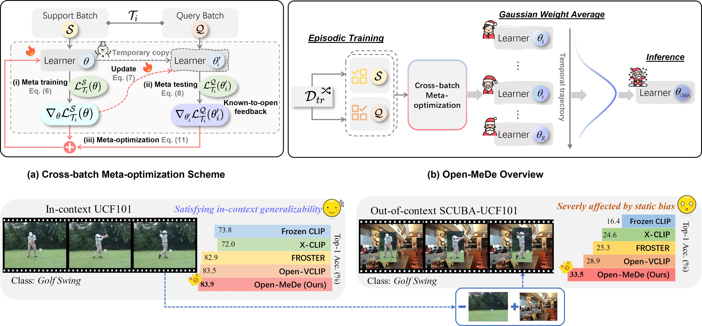

<div align="center">
<h2> 🎉【ICCV'25 Highlight】Learning to Generalize without Bias for Open-Vocabulary Action Recognition </h2>

------
[](https://arxiv.org/pdf/2502.20158)

### Yating Yu, Congqi Cao<sup>✉️</sup>, Yifan Zhang, Yanning Zhang

</div>

This repo is the official implementation of our paper:
[`Learning to Generalize without Bias for Open-vocabulary Action Recognition.`](https://arxiv.org/pdf/2502.20158)

We also have another work accepted by AAAI'25 for zero-shot action recognition: 

> [**Building a Multi-modal Spatiotemporal Expert for Zero-shot Action Recognition with CLIP**](https://arxiv.org/pdf/2412.09895v2)<br>
> Yating Yu, Congqi Cao, Yueran Zhang, Qinyi Lv, Lingtong Min, Yanning Zhang <br>
> [](https://arxiv.org/pdf/2412.09895v2) [](https://github.com/Mia-YatingYu/STDD)
------


## ☃️ Open-MeDe


>  ####  🎄 We introduce **Open-MeDe**, a novel meta-learning framework for open-vocabulary action recognition. 
>  ####  ☃️ It adopts a cross-batch meta-optimization, which encourages the video learner to attain generalizable knowledge counteracting inherent known and static biases for effective known-to-open generalizing and image-to-video debiasing. 
>  ####  🎅 It also incorporates Gaussian Weight Average to achieve generic optima for robust generalization. 
>  ####  🎁 Extensive evaluations in both incontext and out-of-context open-vocabulary scenarios validate the applicability and superiority of our framework.

## 🎨 Dependency

The main dependent packages include: PyTorch 1.13.1 and torchvision 0.14.1 and [`PySlowFast`](https://github.com/facebookresearch/SlowFast)

Detailed Installation instruction can be viewed in [`INSTALL.md`](https://github.com/wengzejia1/Open-VCLIP/blob/main/INSTALL.md).

## 🧸 Data Preparation

---

- **Kinetics-400.**

  We prepare Kinetics-400 dataset by the  [`script`](https://github.com/open-mmlab/mmaction2/blob/main/tools/data/kinetics/download_videos.sh) provided by MMAction2.

- **UCF-101.**

  We download UCF-101 dataset by the [`script`](https://github.com/open-mmlab/mmaction2/blob/main/tools/data/ucf101/download_videos.sh) provided by MMAction2.

- **HMDB-51.**

  We download the HMDB-51 dataset by the [`script`](https://github.com/open-mmlab/mmaction2/blob/main/tools/data/hmdb51/download_videos.sh) provided by MMAction2.

- **Kinetics-600 testing.**

  The validation data of Kinetics-600 we used can be downloaded from [`link`](https://pan.baidu.com/s/1d6wI-n3igMdE1rJ2xP2MsA?pwd=c5mu).

- **SCUBA testing.**

    The validation data of SCUBA we used can be download from [`Google Drive`](https://drive.google.com/drive/folders/1H2_rfwImw6HtUd2PfiASInAy9WylnkSQ) provided by [`StillMix`](https://github.com/lihaoxin05/StillMix).

## 🔥 Training

---

Training scripts of Open-MeDe are provided in **/script/training**. An example script can be viewed bellow.

```sh
ROOT=/PATH/TO/OpenMeDe
CKPT=/PATH/TO/CKPT

# DATA.PATH_PREFIX   # need to replace with the path of the dataset
# TRAIN.CLIP_ORI_PATH # need to replace with the path of CLIP weights

cd $ROOT
export PYTHONPATH=$ROOT/slowfast:$PYTHONPATH
CUDA_VISIBLE_DEVICES=0,1,2,3 \
  python -W ignore -u tools/run_net.py \
  --cfg configs/Kinetics/TemporalCLIP_vitb16_8x16_STAdapter.yaml \
  --opts DATA.PATH_TO_DATA_DIR $ROOT/label_db/weng_compress_full_splits \
  DATA.PATH_PREFIX /data/Kinetics-400/raw/videos_se256 \
  DATA.PATH_LABEL_SEPARATOR , \
  DATA.INDEX_LABEL_MAPPING_FILE $ROOT/label_db/k400-index2cls.json \
  DATA.TEXT_AUG False \
  DATA.TEXT_AUG_FEATURE_FILE $CKPT/text_feats/classes_text_feats_k400_tpl8_xmix_ViT-B_16.pt \
  TRAIN.ENABLE True \
  OUTPUT_DIR $CKPT/expand_FOMAML/vitb16_8x16 \
  TRAIN.BATCH_SIZE 64 \
  TEST.BATCH_SIZE 128 \
  TEST.NUM_ENSEMBLE_VIEWS 3 \
  TEST.NUM_SPATIAL_CROPS 1 \
  NUM_GPUS 4 \
  SOLVER.MAX_EPOCH 22 \
  SOLVER.WARMUP_EPOCHS 2.0 \
  SOLVER.BASE_LR 3.33e-6 \
  SOLVER.WARMUP_START_LR 3.33e-8 \
  SOLVER.COSINE_END_LR 3.33e-8 \
  TRAIN.MIXED_PRECISION True \
  DATA.DECODING_BACKEND "pyav" \
  MODEL.NUM_CLASSES 400 \
  MODEL.TEMPORAL_MODELING_TYPE 'expand_temporal_view' \
  MIXUP.ENABLE False \
  AUG.ENABLE False \
  AUG.NUM_SAMPLE 1 \
  TRAIN.EVAL_PERIOD 1 \
  TRAIN.CHECKPOINT_PERIOD 1 \
  MODEL.LOSS_FUNC soft_cross_entropy \
  TRAIN.LINEAR_CONNECT_CLIMB False \
  TRAIN.CLIP_ORI_PATH /.cache/clip/ViT-B-16.pt \
  TRAIN.CROSS_BATCH_META_LEARN True \
  TRAIN.CROSS_BATCH_META_LEARN_RATIO 1.67e-2 \
  TRAIN.CROSS_BATCH_META_DEBIAS False \
  TRAIN.CROSS_BATCH_META_MIX False \
  DATA_LOADER.NUM_WORKERS 4 \
```

To improve the generalizability of your model, after training, please use `weight_average_tool.py` to average the models from different epochs. **We also provide several model ensemble alternatives**. The source folder `source_dir` should be changed according to your saved path.

```sh
python weight_average_tool.py
```

## 💐 Acknowledgement
This repository is built upon [`OpenVCLIP`](https://github.com/wengzejia1/Open-VCLIP), [`PySlowFast`](https://github.com/facebookresearch/SlowFast) and [`CLIP`](https://github.com/openai/CLIP). Thanks for those well-organized codebases.

## 🔖 Citation
If you find this work useful, please consider citing:

```bibtex
@InProceedings{Yu_2025_ICCV,
    author    = {Yu, Yating and Cao, Congqi and Zhang, Yifan and Zhang, Yanning},
    title     = {Learning to Generalize without Bias for Open-Vocabulary Action Recognition},
    booktitle = {Proceedings of the IEEE/CVF International Conference on Computer Vision (ICCV)},
    month     = {October},
    year      = {2025},
    pages     = {12800-12810}
}
```


